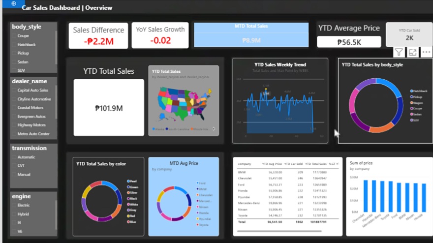

Car Sales Dashboard | Power BI

Project Overview

The Car Sales Dashboard is an interactive data visualization project developed using Microsoft Power BI. It provides insights into car sales performance, revenue trends, vehicle preferences, and dealership performance.

This dashboard helps analyze sales data through interactive visualizations, key performance indicators (KPIs), and filtering options.

Project Objectives

- Monitor overall car sales performance.
- Analyze Month-to-Date (MTD) and Year-to-Date (YTD) sales.
- Evaluate Year-over-Year (YoY) sales growth.
- Track weekly sales trends.
- Identify popular car body styles and colors.
- Compare sales performance across different car manufacturers.
- Provide an interactive dashboard for data-driven decision-making.

Dashboard KPIs

The dashboard includes the following key performance indicators:

  YTD Total Sales – Total sales generated year-to-date.
  MTD Total Sales – Total sales generated month-to-date.
  Sales Difference – Difference in sales performance.
  YoY Sales Growth – Year-over-year sales growth.
  YTD Average Price – Average selling price of vehicles.
  YTD Car Sold – Total number of vehicles sold.

Dashboard Features

1. Sales Performance Analysis
- YTD Total Sales
- MTD Total Sales
- Sales Difference
- YoY Sales Growth
- YTD Average Price

2. Sales Trend Analysis
- Weekly YTD Sales Trend
- Sales performance monitoring over time

3. Vehicle Analysis
- Sales by Body Style
- Sales by Vehicle Color
- Sales by Transmission
- Sales by Engine Type

4. Dealer and Company Analysis
- YTD Total Sales by Company
- MTD Average Price by Company
- Total Sales Comparison by Manufacturer

Interactive Filters

Users can interact with the dashboard using the following slicers:

- Body Style
- Dealer Name
- Transmission
- Engine Type

These filters allow users to explore specific categories and analyze sales performance based on their selections.

Tools and Technologies

- Microsoft Power BI
- Power Query
- DAX (Data Analysis Expressions)
- Data Visualization
- Data Modeling

Dashboard Preview

Project Files

- `CarSalesDashboard.pbix` – Power BI dashboard project file.
- `PBIDashboard.png` – Dashboard screenshot.
- `README.md` – Project documentation.

Project Purpose

This project demonstrates the application of data analytics and business intelligence using Microsoft Power BI. It showcases the use of KPIs, DAX calculations, interactive slicers, and data visualizations to transform raw car sales data into meaningful business insights.

---

Project: Car Sales Dashboard  
Tool: Microsoft Power BI  
Category:Data Analytics / Business Intelligence
